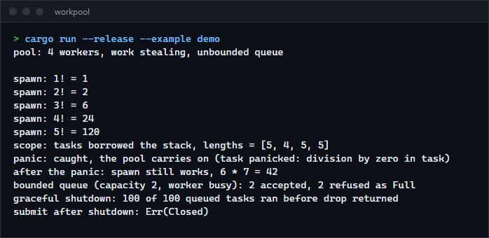
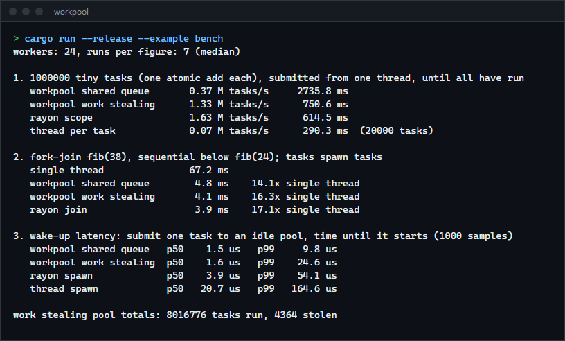

# workpool

A Rust thread pool with a shared queue or per-worker work stealing, bounded queues, scoped tasks that borrow from the stack, panic isolation and graceful shutdown. It uses only the standard library. For anyone who wants to see how a pool is built or needs a small one without pulling in rayon.

**Status:** v0.1.0, working. Not published to crates.io; use it as a git dependency or build from source.



## Features

- `spawn` returns a `JoinHandle` with the task's result; `execute` is fire and forget.
- `scope` runs tasks that borrow local variables and returns when all of them are done.
- Two queue layouts, `Shared` (one FIFO) and `WorkStealing` (a deque per worker plus an injector; thieves take half).
- A panic in a task is caught: the worker survives and `join` returns the message.
- Optional bounded queue: `execute` waits for room, `try_execute` returns `Full`.
- Waiting inside a task (a `join` or a nested `scope` on a worker) runs other queued tasks instead of blocking, so it cannot deadlock the pool, even with one worker.
- Graceful shutdown on drop (everything queued runs) or `shutdown_now` (queued tasks are discarded and their handles report `Cancelled`).
- Counters: tasks run, stolen, panicked, queued, pending.

## How to install

Requires a recent stable Rust (built and tested with 1.98.1). No dependencies.

```toml
[dependencies]
workpool = { git = "https://github.com/r3clusionn/thread-pool-library" }
```

Or build the examples and tests from source:

```sh
git clone https://github.com/r3clusionn/thread-pool-library
cd thread-pool-library
cargo test --release
cargo run --release --example demo
```

## How to use

```rust
use workpool::ThreadPool;

let pool = ThreadPool::new(4);

// A result.
let answer = pool.spawn(|| 6 * 7);
assert_eq!(answer.join().unwrap(), 42);

// Tasks that borrow the stack.
let mut squares = vec![0u64; 8];
pool.scope(|s| {
    for (i, slot) in squares.iter_mut().enumerate() {
        s.spawn(move || *slot = (i * i) as u64);
    }
});

// Fire and forget, then wait for everything.
pool.execute(|| println!("hello from a worker")).unwrap();
pool.join();
```

| Call | What it does |
|---|---|
| `ThreadPool::new(n)` / `ThreadPool::builder()` | Build a pool. The builder sets `threads`, `strategy`, `queue_capacity`, `name` and `stack_size`. |
| `execute(f)` / `try_execute(f)` | Queue a task. Errors are `Closed` and, for a bounded queue, `Full`. |
| `spawn(f)` | Queue a task and get a `JoinHandle<T>`; `join()` returns `Result<T, JoinError>`. |
| `scope(\|s\| ...)` | Spawn tasks that borrow local data. Resumes the first task panic after all tasks have ended. |
| `handle()` | A cloneable submit-only handle to give to tasks and other threads. |
| `join()` | Wait until every submitted task has finished. Not callable from a worker. |
| `shutdown()` / `shutdown_now()` | Finish queued work, or discard it and return how many tasks were dropped. Dropping the pool is `shutdown()`. |
| `stats()` | `executed`, `stolen`, `panicked`, `queued`, `pending`. |

## How it works

- **Work distribution.** In `WorkStealing` mode a task spawned from outside the pool goes to a shared injector. A task spawned from a worker goes to that worker's deque, which the worker pops from the back (the newest task, still hot in cache). An idle worker takes from the injector, then steals half of another worker's deque from the front, so the oldest and usually largest work moves. Each deque is a `Mutex<VecDeque>`; there is no lock-free deque.
- **No lost wake-ups.** A producer increments the queued count, then reads the sleeper count; a worker increments the sleeper count, then re-reads the queued count under the sleep lock. One of the two always sees the other, and the notification is sent under that same lock.
- **Shutdown without races.** `pending` is incremented before the closing flag is checked, and workers exit only when closing is set and `pending` is zero, so a submission that races with shutdown is either rejected or run.
- **Scopes.** `scope` hands the pool a closure with its lifetime erased (the one `unsafe` block). That is sound because `scope` does not return, not even when the caller's closure panics, until every task it spawned has finished.
- **Helping.** A worker that waits (`join`, `scope`) pops and runs other tasks while it waits. A thread outside the pool sleeps instead of running tasks.
- **Idle workers** spin for 64 failed searches before sleeping, so a producer that is still pushing does not pay for a wake-up per task.

## Benchmarks

Measured with `cargo run --release --example bench` (LTO on) on an Intel Core i9-14900KF (24 logical CPUs), Windows 11, Rust 1.98.1, 24 workers in every pool. Each figure is the median of 7 runs after a warm-up run. rayon is 1.x as a dev-dependency, with its pool also at 24 threads. Other programs were running, so expect run-to-run differences of 10 to 20 percent.



| Test | Shared queue | Work stealing | rayon | Thread per task |
|---|---|---|---|---|
| 1,000,000 tiny tasks from one thread, until all have run | 0.37 M/s | 1.33 M/s | 1.63 M/s | 0.07 M/s (20,000 tasks) |
| Fork-join fib(38), sequential below fib(24), 24 workers (single thread: 67.2 ms) | 4.8 ms | 4.1 ms | 3.9 ms | n/a |
| Submit to an idle pool, time until the task starts (median / p99) | 1.5 / 9.8 us | 1.6 / 24.6 us | 3.9 / 54.1 us | 20.7 / 164.6 us |

What the numbers say:

- A single shared queue is the slowest for bursts: 24 workers and the producer all contend on one lock. Per-worker deques remove most of that, and work stealing is within about 20 percent of rayon here.
- Fork-join, where tasks spawn tasks, is about equal to rayon. rayon's `join` is a purpose-built primitive; here the same job goes through `scope`.
- Wake-up latency to an idle pool is low because workers spin briefly and the sleeping path is a plain condition variable. The cost is a short burst of CPU after each task while workers spin.
- Spawning a thread per task is 5 to 23 times slower per task than any of the pools above.

## Tests

`cargo test` runs 17 integration tests and a doc test, for both queue layouts where it applies: every task runs exactly once, results and panics, graceful and immediate shutdown, bounded queues (`Full`, and `execute` blocking until there is room), scopes borrowing the stack and resuming panics, nested scopes and joins on a single worker, tasks spawning tasks, stealing between workers, 300 bursts separated by idle gaps (lost wake-ups) and 8 producers. The integration suite was also run 40 times in a row in release mode and 25 in debug without a failure. It is not run under loom or a sanitizer.

## Limits

- Mutex-based queues; a lock-free deque would be faster under heavy stealing.
- Tasks are boxed closures, so every task costs one allocation.
- No priorities, no task cancellation once running, no async support.
- Workers do not shrink or grow after the pool is built.
- Tested on Windows only; the code uses only `std` and has no platform-specific parts.

## License

MIT (see `LICENSE`).
